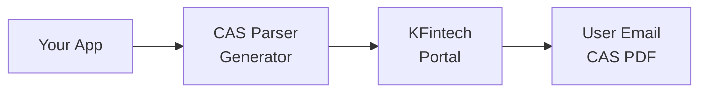

## Overview

CAS Generator triggers a mutual fund CAS statement to be emailed to your user — no manual portal visits needed.

**Coverage:** Uses the KFintech or CAMS email mailback service. KFintech and CAMS have a mutual partnership for data sharing and consolidation, so either one retrieves mutual fund data from **both RTAs** (Registrar and Transfer Agents), covering all mutual funds in India.

**Statement type:** By default, a **Detailed CAS** is generated, which includes the complete transaction history. The parsing layer supports all statement types (Detailed, Summary, etc.), but generation always requests the Detailed variant for maximum data coverage.



**Use cases:**
- Client onboarding (request 50+ years of transaction history)
- Automated monthly portfolio updates
- Filling gaps in transaction history

<Note>
  The CAS is emailed to the user's registered email within a few minutes. The CAS is not returned in the API response.
</Note>

## Request a CAS statement

```python
import requests

response = requests.post(
    "https://api.casparser.in/v4/generate",
    headers={"x-api-key": "YOUR_API_KEY"},
    json={
        "email": "investor@example.com",
        "from_date": "1990-01-01",
        "to_date": "2024-01-15",
        "password": "Abcdefghi12$"
    }
)

data = response.json()
# {"status": "success", "msg": "CAS request submitted. Check email shortly."}
```

## Parameters

| Parameter | Required | Description |
|-----------|----------|-------------|
| `email` | Yes | User's email registered with their RTA (KFintech/CAMS) |
| `pan_no` | No | User's PAN number (optional) |
| `from_date` | Yes | Start date (YYYY-MM-DD) |
| `to_date` | Yes | End date (YYYY-MM-DD) |
| `password` | Yes | Password that protects the emailed PDF. Must satisfy the chosen authority's policy — see below. |
| `cas_authority` | No | Which RTA sends the mailback: `kfintech` (default) or `cams`. Case-insensitive. |

## Choosing the CAS authority

`cas_authority` decides **which RTA sends the email** — nothing else.

You get the **same portfolio** either way. KFintech and CAMS share folio data with each other, so both authorities report the investor's holdings and transactions across every AMC in India. Switching authorities will not surface folios the other one missed, and will not change the fields you get back after parsing.

What it *does* change is the **PDF password policy**, because each RTA enforces its own rule on the self-extraction password:

| Authority | Password policy | Can you use the PAN? |
|-----------|-----------------|----------------------|
| `kfintech` (default) | KFintech's portal policy — stricter, expects a mix of upper and lowercase letters, digits and a special character | No |
| `cams` | 6-20 characters containing at least two digits | **Yes** |

### Why the CAMS password rule matters

A PAN like `ABCDE1234F` is 10 characters with four digits, so it satisfies the CAMS rule. That means you can set the password **to the investor's PAN**:

```python
requests.post(
    "https://api.casparser.in/v4/generate",
    headers={"x-api-key": "YOUR_API_KEY"},
    json={
        "email": "investor@example.com",
        "pan_no": "ABCDE1234F",
        "from_date": "1990-01-01",
        "to_date": "2024-01-15",
        "password": "ABCDE1234F",   # PAN doubles as the PDF password
        "cas_authority": "cams",
    },
)
```

This removes a whole piece of state from your integration. With `kfintech` you have to invent a password, store it against the user, and look it up again when the PDF arrives so you can pass it to `/v4/smart/parse`. With `cams` the password is derivable from data you already hold.

<Note>
  The password is **not** validated against the investor's real PAN by the RTA — it is just a string that locks the PDF. Using the PAN is a convention that makes the password predictable to you, not an authentication step.
</Note>

If you don't already collect PAN, or you'd rather not reuse it as a password, stay on the default `kfintech`.

## Integration patterns

### Pattern 1: Generate + Email Import

Combine CAS Generator with Email Inbox Import for a seamless flow:

```python
# 1. Request CAS generation
requests.post(
    "https://api.casparser.in/v4/generate",
    headers={"x-api-key": API_KEY},
    json={
        "email": "user@gmail.com",
        "from_date": "2020-01-01",
        "to_date": "2024-12-31",
        "password": "Abcdefghi12$"
    }
)

# 2. Wait for email (1-2 minutes)
time.sleep(120)

# 3. Import from inbox (Gmail/Outlook/Zoho)
response = requests.post(
    "https://api.casparser.in/v4/inbox/cas",
    headers={
        "x-api-key": API_KEY,
        "x-inbox-token": inbox_token
    }
)
```

### Pattern 2: User-initiated

Let users trigger generation and upload manually:

```jsx
// Frontend
const requestCAS = async () => {
  await fetch('/api/generate-cas', {
    method: 'POST',
    body: JSON.stringify({ email: user.email, pan: user.pan })
  });
  
  alert('CAS will arrive in your email in 1-2 minutes. Upload it here when received.');
};
```

## Timing expectations

| Step | Duration |
|------|----------|
| API request | < 1 second |
| RTA processing | 1-2 minutes |
| Email delivery | Depends on email provider |

## Date range options

```python
from datetime import datetime, timedelta

# Last 1 year
requests.post(..., json={
    "email": "user@example.com",
    "from_date": (datetime.now() - timedelta(days=365)).strftime("%Y-%m-%d"),
    "to_date": datetime.now().strftime("%Y-%m-%d"),
    "password": "Abcdefghi12$"
})

# Complete transaction history (50+ years)
requests.post(..., json={
    "email": "user@example.com",
    "from_date": "1970-01-01",
    "to_date": datetime.now().strftime("%Y-%m-%d"),
    "password": "Abcdefghi12$"
})
```

## Credit usage

| Operation | Credits |
|-----------|---------|
| Generate CAS | 0.5 |

## Comparison: CDSL Fetch vs CAS Generator

| Feature | CDSL Fetch | CAS Generator |
|---------|------------|---------------|
| **Speed** | Real-time (~20s) | 1-2 minutes |
| **Data source** | CDSL eCAS (all holdings) | KFintech + CAMS (all MFs) |
| **History** | Current holdings | 50+ years transactions |
| **User input** | PAN + BO ID + DOB + OTP | Email + date range |
| **Asset classes** | Demat + Non-Demat (stocks, bonds, MFs, etc.) | Mutual funds |

<Note>
  **Important:** CDSL eCAS statements contain holdings from **both CDSL and NSDL** depositories. Similarly, NSDL eCAS contains both NSDL and CDSL holdings. This is a consolidated view across all depositories, not limited to the issuing depository.
</Note>

## Next steps

<CardGroup cols={2}>
  <Card title="Gmail Import" icon="envelope" href="/guides/gmail-inbox">
    Import the generated CAS
  </Card>
  <Card title="Parsing Guide" icon="file-pdf" href="/guides/parsing">
    Parse uploaded CAS files
  </Card>
</CardGroup>
